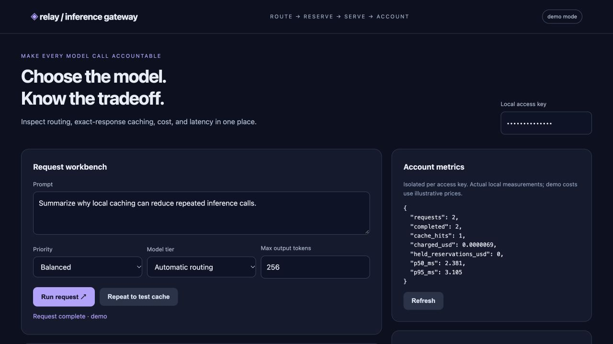
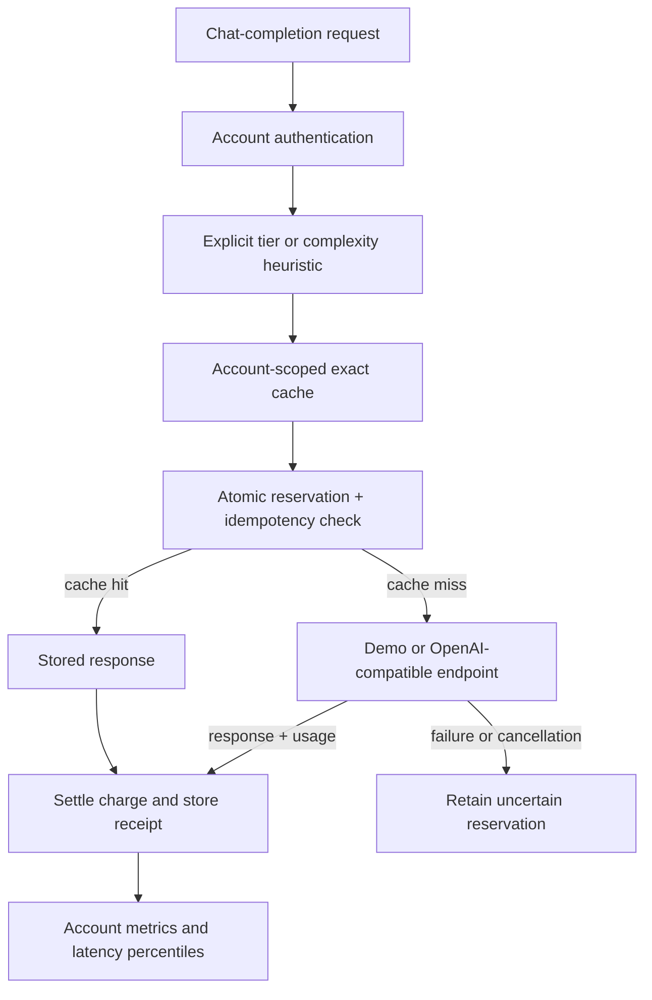

# Inference Budget Gateway

An inspectable inference gateway for consumer AI workloads: route between model tiers, reserve spending before dispatch, cache exact requests within an account, and record token costs and latency.

**Status:** runnable portfolio prototype. The default provider produces deterministic sample text. Optional live mode forwards requests to an OpenAI-compatible model endpoint. Pricing is illustrative configuration, not a current vendor quote. No GPU speedup, model-quality improvement, user adoption, or production savings are asserted.



## The engineering problem

Repeated prompts waste inference calls; sending every request to a large model can also waste capacity. But a routing layer must not leak cached responses between users, double-charge retries, or let concurrent requests independently spend the same remaining budget.

This project makes the control path explicit. It uses conservative input estimates and a transaction to reserve allowance, settles against returned token usage, and keeps reservations when the provider outcome is uncertain.

## Run locally

Requires Python 3.11+.

```bash
git clone https://github.com/stack-overflow-survivor/inference-budget-gateway.git
cd inference-budget-gateway
python3 -m venv .venv
source .venv/bin/activate
pip install -r requirements.lock.txt
uvicorn budget_gateway.app:app --host 127.0.0.1 --port 8012
```

Open [the local workbench](http://127.0.0.1:8012). Default local-only access key: `local-demo-key`. API documentation: `/docs`.

1. Run the default prompt and inspect its route and receipt.
2. Click **Repeat to test cache**: no second provider call, zero new token cost.
3. Choose **Quality** priority to select the large tier.
4. Change the key to a second configured account to observe isolated metrics and cache.
5. Delete stored responses: financial totals remain available.

Container option: `docker compose up --build`. The database uses a persistent named volume. The initial validation did not execute Docker.

## Architecture



| Decision | Current implementation |
|---|---|
| Routing | Small by default; large for quality priority, long input, or complexity keywords; explicit override supported |
| Cache | Exact request fingerprint + resolved model configuration; account-scoped, five-minute TTL, temperature 0 only |
| Idempotency | Unique account/key pair; same request replays its receipt; conflicting payload returns 409 |
| Budget | Per-request estimate cap and daily account allowance; `BEGIN IMMEDIATE` serializes reservations |
| Accounting | Integer nanodollars internally; settle using provider-reported token usage |
| Failure handling | Retain reservation on ambiguous provider failure; no automatic retry |
| Metrics | Completed requests, cache hits, charged amount, held reservations, p50/p95 local gateway duration |
| Privacy | No raw prompts stored; response content can be purged while preserving accounting metadata |

`priority=cost` currently uses the same complexity rules as `balanced`; it is not an optimization algorithm. Cache reuse is exact, not semantic. There is no learned router, quality guarantee, GPU kernel optimization, or quantization in this project.

## OpenAI-style request

```bash
curl -s http://127.0.0.1:8012/v1/chat/completions \
  -H 'Authorization: Bearer local-demo-key' \
  -H 'Idempotency-Key: example-request-1' \
  -H 'Content-Type: application/json' \
  -d '{"model":"auto","messages":[{"role":"user","content":"Summarize this note"}],"max_tokens":128,"max_cost_usd":0.01}'
```

The response follows the basic chat-completion envelope and adds `gateway` metadata. This is a **subset** of the OpenAI API: text messages only; no streaming, tool calls, images, logprobs, or full SDK compatibility guarantee. Unsupported model tiers and streaming requests are rejected.

A caller retry should reuse its `Idempotency-Key`. Without it, each HTTP call is a new request. Cache hits create a new zero-charge receipt; idempotent replays return the original receipt and do not add accounting rows.

## Real inference configuration

```bash
export API_KEYS='replace-with-a-long-random-key,second-account-key'
export MODEL_BASE_URL='http://127.0.0.1:8000/v1'
export SMALL_MODEL='your-small-served-model'
export LARGE_MODEL='your-large-served-model'
export MODEL_API_KEY='your-provider-key'
export DAILY_BUDGET_USD='1'
uvicorn budget_gateway.app:app --host 127.0.0.1 --port 8012
```

The configured endpoint must serve both model names, or use the same name for both tiers during integration testing. This can be an OpenAI-compatible serving proxy or model server. The adapter is tested with mock HTTP responses; **live vLLM integration has not been exercised** here.

Edit `PRICES` in `budget_gateway/engine.py` to match the chosen deployment. The included small-tier input/output rates correspond to $0.10/$0.40 per million tokens, and large-tier rates to $1/$4. They are deliberately illustrative. Changing pricing or model deployments should invalidate cached receipts operationally.

`.env.example` documents configuration. Export variables yourself; the app does not automatically load `.env`.

## Measured local validation

```bash
python -m pytest -q
python evals/run.py
```

Initial local validation: **20 passing tests**. The checked-in [synthetic evaluation](evals/results.json) makes **12 requests** using six distinct prompts repeated once; it records **six cache hits** and **12/12 routing-fixture matches**.

These numbers demonstrate the specified control flow on a tiny fixture. They are not general routing accuracy, LLM quality, workload savings, or real-model throughput measurements. Latencies in the JSON report measure local demo handling, exclude response serialization, and are not GPU inference latency.

Regression tests cover tenant isolation, system-prompt/parameter cache separation, expiry, sampling bypass, idempotent replay/conflict/in-flight duplication, usage accounting, budget rejection, concurrent reservations, retained reservations on failure, metrics isolation, privacy purging, provider contract mapping, and underestimated-usage reporting.

CI runs the suite and synthetic evaluation on Python 3.11/3.12. Dependency versions from the clean local validation are recorded in `requirements.lock.txt`.

## Operational boundaries

- **Budget estimates are not hard provider billing caps.** Input estimates use UTF-8 byte counts plus overhead, not the provider's tokenizer. Provider usage can exceed the reservation; the receipt flags this and accounts for the full returned usage. Already-dispatched requests cannot be unspent.
- Daily accounting uses UTC. In-flight and uncertain reservations from previous days remain held. An operator must reconcile an uncertain request against provider receipts before adjusting it; there is no automatic release or reconciliation UI.
- No cross-request single-flight cache fill: concurrent identical prompts with different idempotency keys may both call the provider.
- Cache expiry is lazy. Idempotency response content remains until `DELETE /responses`; accounting metadata and key tombstones remain afterward. Establish scheduled retention before production use.
- API keys are a prototype account mechanism. Do not expose default demo keys publicly. There is no full user lifecycle, rate limiter, or encrypted storage.
- SQLite coordinates local processes but does not provide a distributed reservation service. Migration to PostgreSQL transactions and Redis caching is future work.
- No autonomous external URLs or client-supplied model endpoints. Only the operator-configured provider is called.
- Tests emit an upstream Starlette/httpx deprecation warning; assertions pass.

## Interview walkthrough

Follow `route()` into `Ledger.reserve()` and explain why budget checking and reservation must share a transaction. Demonstrate idempotent replay, cross-account cache separation, and the response-purge accounting invariant. Discuss why a timeout cannot prove the provider did no work, and what real quality/latency evaluations are needed before using heuristic routing in a consumer product.

MIT licensed.
